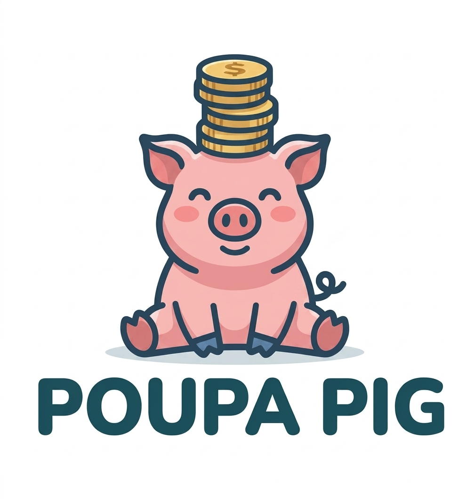

# 🐷 Poupa Pig

> Uma pausa entre ver o produto e comprar o produto.



## Sobre o projeto

O Poupa Pig é um sistema web responsivo que ajuda o usuário a registrar decisões de compra, aplicar um período de "quarentena" antes de decidir, e visualizar o impacto financeiro dessas decisões ao longo do tempo.

## Problema que resolve

Muitas pessoas fazem compras por impulso, especialmente online, sem dar tempo pra avaliar se realmente precisam do item. Esse padrão de consumo gera gasto desnecessário e arrependimento posterior, mas falta uma ferramenta simples que force uma pausa entre "ver o produto" e "comprar o produto". Diferente de apps de finanças tradicionais (que registram gastos já feitos), o Poupa Pig intervém *antes* da compra acontecer.

## Público-alvo

Pessoas que querem controlar melhor o próprio consumo por impulso — sem perfil técnico específico. Sistema pensado para uso pessoal via navegador (desktop ou celular).

<br clear="right">

## Funcionalidades

- Cadastro e login de usuário (autenticação via banco, senha com hash)
- Itens: criar, editar e remover (nome, preço, link/imagem, categoria, motivo, prazo de quarentena)
- Categorias personalizadas por usuário
- Decisão do item: comprei ou desisti; o item sem decisão fica como "ainda pensando"
- Dashboard mensal com o porquinho da economia e o resumo das decisões
- Reviews de produtos
- Configurações: nome, senha, foto, cor principal e exclusão de conta
- Front-end responsivo

## A fazer

- Recuperação de senha por e-mail (as telas existem, falta o backend)
- Sair da conta (logout)

## Fora do escopo

- Extensão do prazo da quarentena
- Lembrete do motivo ao vencer a quarentena
- Ranking de categorias e evolução semanal no dashboard
- Simulador de "e se tivesse comprado tudo"
- Preço de referência via API do Mercado Livre
- Exportação do histórico em PDF/CSV

## Tecnologias


## Documentação do projeto

- [Requisitos e regras de negócio](docs/REQUISITOS.md)
- [Front-end](docs/FRONTEND.md)
- [Back-end](docs/BACKEND.md)
- [Banco de dados (schema, dicionário de dados e MER/DER)](docs/BANCO.md)
- [Design Guide](docs/DESIGN_GUIDE.md)
- [Manual de Identidade Visual](docs/IDENTIDADE_VISUAL.md)
- [Instruções para agentes de IA](AGENTS.md)
- [Project Exchange](docs/PROJECT_EXCHANGE.md)

## Estrutura do projeto

```
poupa-pig/
├── frontend/
│   ├── index.php
│   ├── pages/
│   ├── components/
│   ├── assets/{images,icons,logos}/
│   └── uploads/{items,users}/
├── backend/
│   ├── config/
│   ├── controllers/
│   ├── models/
│   └── services/
├── database/
│   ├── migrations/
│   ├── seeds/{products,demo}.sql
│   ├── queries/{dml,dql}.sql
│   ├── dump/poupa_pig.sql
│   └── database.sql
├── docs/
├── .github/
│   ├── ISSUE_TEMPLATE/
│   ├── PULL_REQUEST_TEMPLATE/
│   ├── PULL_REQUEST_TEMPLATE.md
│   └── CODEOWNERS
├── .gitignore
├── AGENTS.md
└── README.md
```

## Como executar

1. Clone o repositório: `git clone https://github.com/senac-pis/poupa-pig`
2. Copie a pasta do projeto para `htdocs/` do XAMPP
3. Inicie o Apache e o MySQL pelo painel do XAMPP
4. Importe pelo phpMyAdmin, nesta ordem:
   1. `database/database.sql` (cria o banco `projeto_integrador` e as tabelas)
   2. `database/seeds/products.sql` (produtos das reviews)
5. Copie `backend/config/database.example.php` para `backend/config/database.php` e troque
   `nome_do_banco` por `projeto_integrador`
6. Acesse `http://localhost/poupa-pig` no navegador

## Equipe

| Integrante | Responsabilidade |
|---|---|
| Kaio | Gerenciamento do projeto e front-end |
| Levi | Back-end |
| Lucas | Banco de dados |

## Links

- Figma: [Poupa Pig](https://www.figma.com/design/m9gI8kevph97sNSiFql9Ki/poupa-pig?node-id=0-1&t=AKTjgEf1Ks2EAlQu-1)
- Trello: [Poupa Pig](https://trello.com/invite/b/6a8a682f172e2057c6c1dd4c/ATTIe238042ab16ef4737719ffb31929012388465147/poupa-pig)
- Repositório: [senac-pis/poupa-pig](https://github.com/senac-pis/poupa-pig)