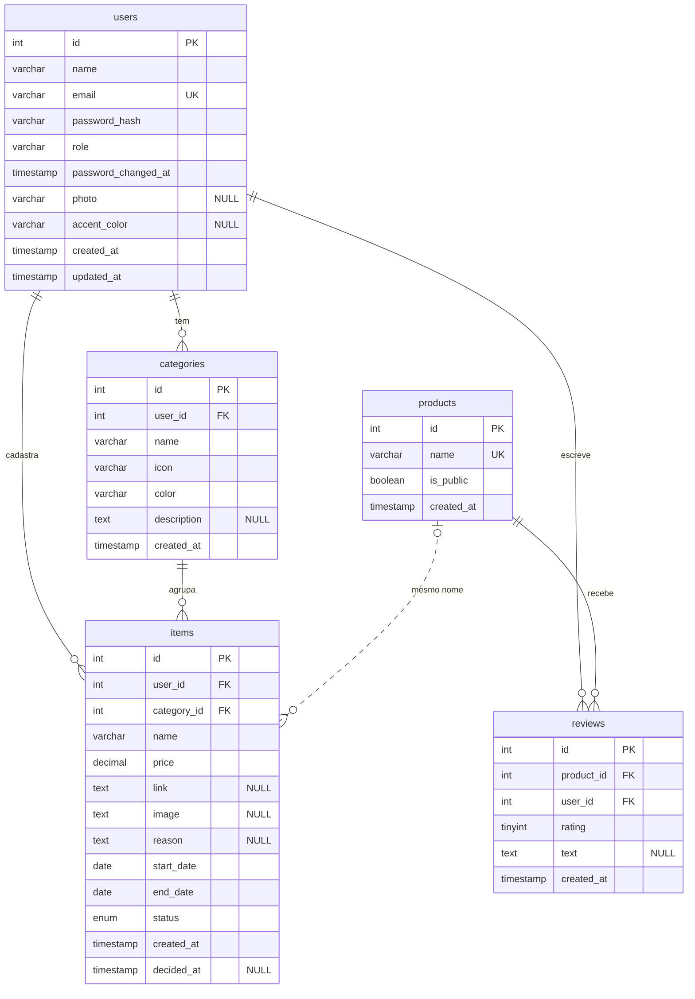

# Banco de dados do Poupa Pig

Documentação do banco MySQL. Cobre o schema, o MER/DER, o dicionário de dados e os scripts SQL
(DDL, DML, DQL, migrations e dump).

> Tudo aqui descreve o banco como ele está em `database/database.sql` e as consultas como estão
> em `backend/models/`. Se mudar o schema, atualize este arquivo, o DDL e crie uma migration.

## 1. Visão geral

- **SGBD:** MySQL, o do XAMPP (MariaDB). O banco se chama `projeto_integrador`.
- **Codificação:** `utf8mb4` com a collation `utf8mb4_unicode_ci`. Por causa dela, as comparações
  de texto **não diferenciam maiúsculas nem acentos** ("Tênis" = "tenis"). O nome do produto
  depende disso.
- **Motor:** InnoDB (o padrão), que tem chaves estrangeiras e transações.
- **Acesso:** o PHP conecta por PDO (`backend/config/connection.php`) e só usa prepared
  statements. Os models de `backend/models/` concentram todas as queries.
- **Isolamento por usuário:** todas as queries de `items` e `categories` filtram por `user_id`
  (o da sessão). Um usuário nunca vê nem altera dados de outro. `products` é a única tabela
  compartilhada: as reviews de um produto são de todos.

### Tabelas

| Tabela       | O que guarda                                                          |
| ------------ | --------------------------------------------------------------------- |
| `users`      | Contas: login, foto e cor principal                                   |
| `categories` | Categorias de cada usuário (nome, ícone, cor)                         |
| `items`      | Desejos de compra em quarentena e a decisão (comprei / desisti)       |
| `products`   | Produtos compartilhados para as reviews, identificados pelo nome      |
| `reviews`    | Nota (1 a 5) e resenha de um usuário sobre um produto                 |

## 2. Scripts SQL

```text
database/
├── database.sql                 # DDL: cria o banco, as tabelas e as restrições
├── seeds/
│   ├── products.sql             # DML: catálogo de produtos do autocompletar (obrigatório)
│   └── demo.sql                 # DML: usuários e dados fictícios para demonstração (opcional)
├── queries/
│   ├── dml.sql                  # DML: INSERT/UPDATE/DELETE dos models, comentados
│   └── dql.sql                  # DQL: SELECT dos models, comentados
├── migrations/
│   ├── 001_create_users_category_items.sql
│   ├── 002_categories_per_user_and_item_period.sql
│   ├── 003_categories_color_default.sql
│   ├── 004_users_password_changed_at.sql
│   ├── 005_users_photo_and_accent_color.sql
│   └── 006_create_products_reviews.sql
└── dump/
    └── poupa_pig.sql            # dump (mysqldump): estrutura + catálogo + demonstração
```

| Tipo          | Arquivo                      | Para que serve                                                                 |
| ------------- | ---------------------------- | ------------------------------------------------------------------------------ |
| DDL           | `database.sql`               | Estrutura atual completa: `CREATE DATABASE`, `CREATE TABLE`, PK, FK, UNIQUE, CHECK |
| DML           | `seeds/products.sql`         | Insere os 359 produtos do catálogo. Pode rodar de novo (`ON DUPLICATE KEY UPDATE`) |
| DML           | `seeds/demo.sql`             | 2 usuários fictícios, categorias, itens nos 3 status e reviews. Pode rodar de novo |
| DML           | `queries/dml.sql`            | Cada escrita do sistema em SQL puro. Roda dentro de uma transação com `ROLLBACK` |
| DQL           | `queries/dql.sql`            | Cada consulta do sistema em SQL puro, com a função PHP de origem. Só lê        |
| Migrations    | `migrations/001` a `006`     | Como o banco evoluiu, passo a passo (ver a seção 6)                            |
| Dump          | `dump/poupa_pig.sql`         | Tudo pronto em um arquivo só, gerado com `mysqldump`                           |

### Como criar o banco

O caminho padrão (o mesmo do `README.md`): no phpMyAdmin, importe nesta ordem:

1. `database/database.sql`
2. `database/seeds/products.sql`
3. (opcional) `database/seeds/demo.sql`: entra com `demo@poupapig.test`, senha `poupapig123`

Alternativas:

- **Dump:** importar só o `database/dump/poupa_pig.sql`, que equivale aos três passos acima.
  Ele **apaga e recria** as tabelas (`DROP TABLE IF EXISTS`) e foi gerado no MySQL (a
  importação no MariaDB do XAMPP não foi testada). As datas dos itens de demonstração ficam
  fixas no dia em que o dump foi gerado; o `demo.sql` usa datas relativas ao dia em que roda.
- **Migrations:** rodar `001` a `006` em ordem dá exatamente o mesmo schema do `database.sql`
  (conferido comparando o `SHOW CREATE TABLE` das 5 tabelas). Depois, rodar os seeds.

Pela linha de comando, o equivalente ao caminho padrão:

```bash
mysql -u root < database/database.sql
```

```bash
mysql -u root < database/seeds/products.sql
```

## 3. MER / DER

### Modelo conceitual (MER)

- Um **usuário** tem várias **categorias**; cada categoria é de um usuário só.
- Um **usuário** cadastra vários **itens**; cada item é de um usuário só.
- Uma **categoria** agrupa vários **itens**; cada item está em exatamente uma categoria.
- Um **usuário** escreve várias **reviews**; um **produto** recebe várias reviews; cada review é
  de um usuário sobre um produto. Um usuário avalia cada produto **no máximo uma vez**, então a
  relação usuário–produto é N:N e `reviews` é a tabela associativa (com atributos próprios:
  nota e texto).
- Um **item** corresponde a um **produto** pelo nome. É uma ligação **lógica**, sem chave
  estrangeira (ver a seção 5).

### Diagrama entidade-relacionamento (DER)

As linhas cheias são chaves estrangeiras; a pontilhada é a ligação lógica pelo nome.



### Relacionamentos e regras de exclusão

| Chave estrangeira    | De                     | Para             | Cardinalidade | Ao excluir o "pai"                          |
| -------------------- | ---------------------- | ---------------- | ------------- | ------------------------------------------- |
| `fk_categories_user` | `categories.user_id`   | `users.id`       | 1 : N         | `CASCADE`: as categorias saem junto         |
| `fk_items_user`      | `items.user_id`        | `users.id`       | 1 : N         | `CASCADE`: os itens saem junto              |
| `fk_items_category`  | `items.category_id`    | `categories.id`  | 1 : N         | `RESTRICT`: não exclui categoria com itens  |
| `fk_reviews_product` | `reviews.product_id`   | `products.id`    | 1 : N         | `CASCADE`: as reviews saem junto            |
| `fk_reviews_user`    | `reviews.user_id`      | `users.id`       | 1 : N         | `CASCADE`: as reviews saem junto            |

O `RESTRICT` de `fk_items_category` é de propósito: o backend recusa (e avisa) a exclusão de
categoria com itens. Por causa dele, ao excluir a conta o backend apaga os itens antes
das categorias, numa transação (`deleteUserAccount` no `UserModel`).

## 4. Dicionário de dados

Legenda: **PK** chave primária, **FK** chave estrangeira, **UK** valor único, **AI**
auto incremento. Todos os `INT` são `UNSIGNED`. "Sim" em Nulo quer dizer que a coluna aceita
`NULL`.

### 4.1 `users`

Contas de acesso. Veio do template da disciplina e ganhou campos para a tela de Configurações.

| Coluna                | Tipo           | Nulo | Padrão                                         | Chave  | Descrição                                                                                  |
| --------------------- | -------------- | ---- | ---------------------------------------------- | ------ | ------------------------------------------------------------------------------------------ |
| `id`                  | `INT UNSIGNED` | Não  | AI                                             | PK     | Identificador do usuário                                                                   |
| `name`                | `VARCHAR(120)` | Não  |                                                |        | Nome exibido no sistema (o backend limita a 120 caracteres)                                |
| `email`               | `VARCHAR(180)` | Não  |                                                | UK     | E-mail de login. Não pode repetir                                                          |
| `password_hash`       | `VARCHAR(255)` | Não  |                                                |        | Hash da senha gerado por `password_hash()` do PHP. A senha pura nunca é gravada            |
| `role`                | `VARCHAR(50)`  | Não  | `'user'`                                       |        | Perfil de acesso. Veio do template; **o sistema ainda não usa**                            |
| `password_changed_at` | `TIMESTAMP`    | Não  | `CURRENT_TIMESTAMP`                            |        | Última troca de senha. A tela de Configurações mostra há quantos dias foi                  |
| `photo`               | `VARCHAR(255)` | Sim  | `NULL`                                         |        | Nome do arquivo da foto de perfil, gerado pelo servidor (32 caracteres hex + `.jpg`/`.png`) |
| `accent_color`        | `VARCHAR(20)`  | Sim  | `NULL`                                         |        | Cor principal escolhida (ex.: `green-400`). `NULL` usa a cor padrão                        |
| `created_at`          | `TIMESTAMP`    | Não  | `CURRENT_TIMESTAMP`                            |        | Data do cadastro                                                                           |
| `updated_at`          | `TIMESTAMP`    | Não  | `CURRENT_TIMESTAMP ON UPDATE CURRENT_TIMESTAMP` |        | Última alteração da linha, atualizada pelo próprio MySQL                                   |

### 4.2 `categories`

Categorias de cada usuário. Cada pessoa tem as suas; não existe categoria global.

| Coluna        | Tipo           | Nulo | Padrão              | Chave | Descrição                                                                                     |
| ------------- | -------------- | ---- | ------------------- | ----- | --------------------------------------------------------------------------------------------- |
| `id`          | `INT UNSIGNED` | Não  | AI                  | PK    | Identificador da categoria                                                                    |
| `user_id`     | `INT UNSIGNED` | Não  |                     | FK    | Dono da categoria (`users.id`, `ON DELETE CASCADE`)                                           |
| `name`        | `VARCHAR(120)` | Não  |                     |       | Nome da categoria                                                                             |
| `icon`        | `VARCHAR(50)`  | Não  | `'box-seam'`        |       | Chave do ícone (ex.: `smartphone`). Valores aceitos em `backend/config/categories.php`; `box-seam` é só o padrão e não aparece no seletor |
| `color`       | `VARCHAR(50)`  | Não  | `'gray-200'`        |       | Chave da cor no formato família-tom (ex.: `sky-200`). `gray-200` é só o padrão               |
| `description` | `TEXT`         | Sim  | `NULL`              |       | Descrição opcional                                                                            |
| `created_at`  | `TIMESTAMP`    | Não  | `CURRENT_TIMESTAMP` |       | Data de criação                                                                               |

### 4.3 `items`

O centro do sistema: cada linha é um desejo de compra que passa pela quarentena antes da decisão.

| Coluna        | Tipo                                      | Nulo | Padrão              | Chave | Descrição                                                                                     |
| ------------- | ----------------------------------------- | ---- | ------------------- | ----- | --------------------------------------------------------------------------------------------- |
| `id`          | `INT UNSIGNED`                            | Não  | AI                  | PK    | Identificador do item                                                                         |
| `user_id`     | `INT UNSIGNED`                            | Não  |                     | FK    | Dono do item (`users.id`, `ON DELETE CASCADE`)                                                |
| `category_id` | `INT UNSIGNED`                            | Não  |                     | FK    | Categoria (`categories.id`, `ON DELETE RESTRICT`). Precisa ser do mesmo usuário (o backend confere) |
| `name`        | `VARCHAR(180)`                            | Não  |                     |       | Nome do que a pessoa quer comprar. Também identifica o produto nas reviews                    |
| `price`       | `DECIMAL(10,2)`                           | Não  |                     |       | Preço em reais. `DECIMAL` para não ter erro de arredondamento com dinheiro                    |
| `link`        | `TEXT`                                    | Sim  | `NULL`              |       | Link da loja (opcional)                                                                       |
| `image`       | `TEXT`                                    | Sim  | `NULL`              |       | Nome do arquivo da foto do item, gerado pelo servidor (opcional)                              |
| `reason`      | `TEXT`                                    | Sim  | `NULL`              |       | Motivo da compra. Previsto no início; **o sistema ainda não usa**                             |
| `start_date`  | `DATE`                                    | Não  |                     |       | Data de inclusão (escolhida pela pessoa): início da quarentena. Os filtros e o Dashboard usam esta data |
| `end_date`    | `DATE`                                    | Não  |                     |       | Fim da quarentena: a partir daqui a pessoa decide                                             |
| `status`      | `ENUM('thinking', 'bought', 'gave_up')`   | Não  | `'thinking'`        |       | `thinking` = pensando (em quarentena); `bought` = comprei; `gave_up` = desisti                |
| `created_at`  | `TIMESTAMP`                               | Não  | `CURRENT_TIMESTAMP` |       | Quando a linha foi criada (registro técnico; a data que a tela mostra é `start_date`)         |
| `decided_at`  | `TIMESTAMP`                               | Sim  | `NULL`              |       | Quando a pessoa decidiu. Fica `NULL` enquanto o status é `thinking`                           |

### 4.4 `products`

Produtos das reviews, compartilhados entre todos os usuários.

| Coluna       | Tipo           | Nulo | Padrão              | Chave | Descrição                                                                                     |
| ------------ | -------------- | ---- | ------------------- | ----- | --------------------------------------------------------------------------------------------- |
| `id`         | `INT UNSIGNED` | Não  | AI                  | PK    | Identificador do produto                                                                      |
| `name`       | `VARCHAR(180)` | Não  |                     | UK    | Nome do produto (`uq_products_name`). Único sem diferenciar maiúsculas nem acentos, pela collation |
| `is_public`  | `BOOLEAN`      | Não  | `FALSE`             |       | `TRUE` = do catálogo (`seeds/products.sql`), aparece para todos no autocompletar              |
| `created_at` | `TIMESTAMP`    | Não  | `CURRENT_TIMESTAMP` |       | Data de criação                                                                               |

`BOOLEAN` no MySQL é um apelido de `TINYINT(1)`: guarda `0` ou `1`.

### 4.5 `reviews`

Avaliações: a tabela associativa entre `users` e `products`.

| Coluna       | Tipo               | Nulo | Padrão              | Chave | Descrição                                                                          |
| ------------ | ------------------ | ---- | ------------------- | ----- | ---------------------------------------------------------------------------------- |
| `id`         | `INT UNSIGNED`     | Não  | AI                  | PK    | Identificador da review                                                            |
| `product_id` | `INT UNSIGNED`     | Não  |                     | FK    | Produto avaliado (`products.id`, `ON DELETE CASCADE`)                              |
| `user_id`    | `INT UNSIGNED`     | Não  |                     | FK    | Autor (`users.id`, `ON DELETE CASCADE`)                                            |
| `rating`     | `TINYINT UNSIGNED` | Não  |                     |       | Nota de 1 a 5 (`chk_reviews_rating`)                                               |
| `text`       | `TEXT`             | Sim  | `NULL`              |       | Resenha (opcional)                                                                 |
| `created_at` | `TIMESTAMP`        | Não  | `CURRENT_TIMESTAMP` |       | Data da review                                                                     |

Restrição extra: `uq_reviews_product_user` (`product_id`, `user_id`) é única, então cada usuário
faz no máximo uma review por produto.

### 4.6 Restrições e índices

| Nome                       | Tabela       | Tipo                        | Regra                                    |
| -------------------------- | ------------ | --------------------------- | ---------------------------------------- |
| `PRIMARY`                  | todas        | PK                          | `id` auto incremento                     |
| `email`                    | `users`      | UNIQUE                      | E-mail não repete                        |
| `uq_products_name`         | `products`   | UNIQUE                      | Nome de produto não repete               |
| `uq_reviews_product_user`  | `reviews`    | UNIQUE composto             | Uma review por usuário em cada produto   |
| `chk_reviews_rating`       | `reviews`    | CHECK                       | `rating BETWEEN 1 AND 5`                 |
| `fk_*`                     | ver seção 3  | FOREIGN KEY (com índice)    | O InnoDB cria um índice para cada FK     |

## 5. Regras de negócio que moram no banco

- **Quarentena:** o item nasce `thinking`. A decisão é um `UPDATE ... WHERE status = 'thinking'`,
  o que impede decidir duas vezes mesmo com dois cliques (`decideItem`). Ao decidir, o MySQL grava
  `decided_at`.
- **Hoje é o do banco:** o Dashboard pega o dia de hoje com `SELECT CURRENT_DATE`, porque é o
  MySQL que grava `decided_at` (o PHP local roda em outro fuso).
- **Produto pelo nome:** não há FK entre `items` e `products`. O produto de um item é o
  `products.name` igual ao nome do item com os espaços juntados
  (`REGEXP_REPLACE(TRIM(name), '[[:space:]]+', ' ')`), comparado pela collation. O backend cria
  os produtos que faltam ao abrir a tela de Reviews (`syncUserProducts`). Foi escolhido assim
  porque o mesmo produto aparece nos itens de várias pessoas, cada uma digitando o nome do seu
  jeito.
- **Privacidade dos produtos:** um produto criado a partir do item de alguém só aparece para os
  outros se for do catálogo (`is_public`) ou se já tiver pelo menos uma review
  (`productIsPublic`, `listProductSuggestions`).

## 6. Migrations (evolução do schema)

O projeto não usa ferramenta de migration; cada arquivo é um SQL para rodar em ordem. Os passos
foram reconstruídos a partir do histórico do Git do `database.sql`.

| Arquivo                                         | Data       | Mudança                                                                                      |
| ----------------------------------------------- | ---------- | -------------------------------------------------------------------------------------------- |
| `001_create_users_category_items.sql`           | 28/08/2026 | Cria o banco, `users`, `category` (ainda sem dono) e `items` com um prazo só (`thinking_deadline`) |
| `002_categories_per_user_and_item_period.sql`   | 11 a 18/11 | `category` vira `categories` com `user_id`, ícone, cor e descrição; o prazo vira `start_date` + `end_date` |
| `003_categories_color_default.sql`              | 24/11/2026 | Cor padrão `gray` vira `gray-200` (formato família-tom)                                      |
| `004_users_password_changed_at.sql`             | 24/11/2026 | `users.password_changed_at` para a tela de Configurações                                     |
| `005_users_photo_and_accent_color.sql`          | 25/11/2026 | `users.photo` e `users.accent_color`                                                         |
| `006_create_products_reviews.sql`               | 25/11/2026 | Tabelas `products` (com `is_public`) e `reviews`                                             |

Daqui em diante, cada mudança de schema deve ter: uma migration nova (`007_...sql`), o
`database.sql` atualizado com o resultado e este documento atualizado.

## 7. Consultas (DQL) e escritas (DML) do sistema

`database/queries/dql.sql` e `database/queries/dml.sql` têm cada query dos models reescrita como
SQL puro, comentada e com a função PHP de origem. Os parâmetros do PDO (`:user_id`) viram
variáveis do MySQL (`@user_id`), então os dois arquivos rodam direto no phpMyAdmin (o DQL fica
melhor depois do `seeds/demo.sql`). O DML roda dentro de `START TRANSACTION ... ROLLBACK` e não
altera nada.

Recursos de SQL usados, para referência:

| Recurso                                   | Onde                                                                 |
| ----------------------------------------- | -------------------------------------------------------------------- |
| `JOIN` / `LEFT JOIN`                      | Itens com a categoria; categorias com a contagem de itens (inclui as vazias) |
| `GROUP BY` + `COUNT` / `AVG` + `HAVING`   | Contagem de itens por categoria; média de notas e filtro por nota    |
| Subconsulta com `EXISTS` / `NOT EXISTS`   | Produtos dos itens do usuário; criar só os produtos que faltam       |
| Subconsulta correlacionada                | Quantas reviews o autor já fez (`listProductReviews`)                |
| Subconsulta no `FROM`                     | Total da lista de Reviews com `GROUP BY` (`countUserProducts`)       |
| `UNION`                                   | Sugestões do autocompletar (catálogo + itens do usuário)             |
| `INSERT ... SELECT` + `ON DUPLICATE KEY`  | `syncUserProducts` e o seed do catálogo                              |
| `LIMIT ... OFFSET`                        | Paginação de todas as listas                                         |
| Funções de data                           | `DATEDIFF`, `DATE`, `CURRENT_DATE`, `CURRENT_TIMESTAMP`              |
| Transação                                 | Exclusão de conta (`deleteUserAccount`)                              |

## 8. Pontos de atenção

- `users.role` e `items.reason` existem, mas nenhum código os usa. Ficaram para quando
  houver perfis de acesso e o campo de motivo no item.
- `items.created_at` e `items.start_date` parecem a mesma coisa, mas não são: `start_date` é a
  data que a pessoa escolhe e a tela mostra; `created_at` é quando a linha foi gravada.
- Os valores aceitos para `categories.icon`, `categories.color` e `users.accent_color` são
  validados no PHP (`backend/config/categories.php`), não no banco.
